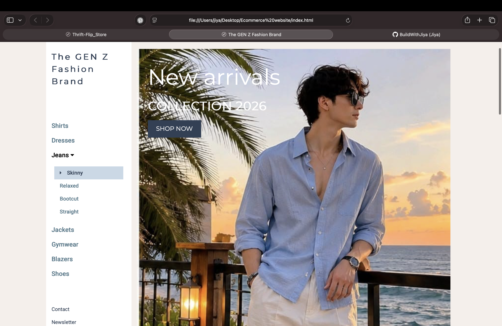

# Ecommerce-site
# The GEN Z Fashion Brand
The GEN Z Fashion Brand is a fashion-focused e-commerce front-end project designed to showcase modern clothing collections and trending styles for the Gen Z generation.
A responsive e-commerce website built using HTML, CSS, and JavaScript, featuring a clean UI and user friendly shopping experience.

# Project Objective

To practice front-end web development by creating a visually engaging fashion e-commerce interface inspired by Gen Z trends.

